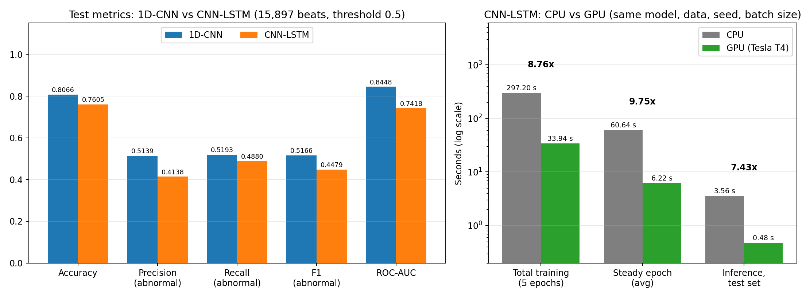

# ❤️ GPU-Accelerated ECG Signal Classification

[](https://ecg-project-deeplearning-6383kyappwquwvbrmgodag6.streamlit.app/)
[](https://github.com/mrrohan4321/ECG-Project-Deeplearning)
[](https://youtu.be/or2yRLIMrqw)


**Group 7 · Deep Learning Project** — classifying ECG heartbeats as **Normal** or **Abnormal** with a **1D-CNN** and a **CNN-LSTM** on the MIT-BIH Arrhythmia Database, and measuring how much a **GPU** speeds up training and inference compared to a CPU.

> ⚠️ This is an educational project. The output is a classification result, **not a clinical diagnosis**.

---

## 🌐 Live Application

Try the demo directly in your browser, no installation needed:

👉 **[ecg-project-deeplearning.streamlit.app](https://ecg-project-deeplearning-6383kyappwquwvbrmgodag6.streamlit.app/)**

The app asks for `ecg_processed_v1.npz` once (download link in the [Processed Data](#-processed-data) section). The free Streamlit app sleeps when unused, so if you see *"Wake this app up"*, click the button and wait a few seconds.

| 🔗 Resource | Link |
|---|---|
| 🎬 Demo video | [youtu.be/or2yRLIMrqw](https://youtu.be/or2yRLIMrqw) |
| 📄 Final report | [`report/report_v1.pdf`](report/report_v1.pdf) · [Word version](report/report_v1.docx) |
| 📊 Presentation (10 slides) | [`presentation/Group7_ECG_Presentation.pptx`](presentation/Group7_ECG_Presentation.pptx) |
| 💾 Processed data (~134 MB) | [Google Drive](https://drive.google.com/file/d/1TO043QL8KSBiMkkf4Di5MMbLF5wXGgT0/view) |

---

## 🌟 Key Features

1. **Two Deep Learning Models**
   - **1D-CNN**: 2 convolution blocks, 379,265 parameters.
   - **CNN-LSTM**: 3 convolution blocks followed by an LSTM layer to capture temporal patterns.

2. **Leakage-Free Evaluation**
   - Record-wise (patient-wise) split: no patient appears in more than one of train / validation / test.
   - Test set = 7 completely unseen records (15,897 beats).

3. **Imbalance-Aware Training**
   - Only 10.5% of beats are abnormal, so training uses balanced class weights.
   - Models are judged by recall, F1, ROC-AUC and the confusion matrix, not accuracy alone.

4. **CPU vs GPU Benchmark**
   - Same model, data, seed and batch size on a 2-core Xeon CPU and a Tesla T4 GPU.
   - Up to **9.75× faster** training and **7.43× faster** inference on GPU.

5. **Interactive 4-Step Streamlit Demo**
   - Pick a test beat or upload your own ECG (`.csv`, `.txt`, `.npy`) → see preprocessing → get both model predictions with P(abnormal) → view evaluation tables.
   - Every number in the evaluation step is read directly from `results/*.csv`, nothing is hardcoded.

6. **Fully Reproducible**
   - Fixed seed (42), identical settings across models, and the exact hardware/library versions are logged in [`results/hardware_info_v1.json`](results/hardware_info_v1.json).

---
 
## 🔄 Pipeline

```mermaid
flowchart LR
    A[MIT-BIH ECG<br/>360 Hz, 44 records] --> B[Bandpass filter<br/>0.5–45 Hz]
    B --> C[360-sample beat window<br/>centred on R-peak]
    C --> D[Z-score<br/>normalisation]
    D --> E[1D-CNN]
    D --> F[CNN-LSTM]
    E --> G{P&#40;abnormal&#41; ≥ 0.5?}
    F --> G
    G -->|yes| H[🔴 Abnormal]
    G -->|no| I[🟢 Normal]
```
 

 
---

## 📈 Results at a Glance

### Model comparison (test set: 15,897 beats from 7 unseen records, threshold 0.5)

| Metric | 1D-CNN | CNN-LSTM |
|---|---|---|
| Accuracy | **0.8066** | 0.7605 |
| Precision (abnormal) | **0.5139** | 0.4138 |
| Recall (abnormal) | **0.5193** | 0.4880 |
| F1-score (abnormal) | **0.5166** | 0.4479 |
| Specificity | **0.8780** | 0.8282 |
| ROC-AUC | **0.8448** | 0.7418 |
| Confusion matrix (TN / FP / FN / TP) | 11179 / 1554 / 1521 / 1643 | 10546 / 2187 / 1620 / 1544 |



### CPU vs GPU (CNN-LSTM, same model, data, seed, batch size; 5 epochs, no early stopping)

| Metric | CPU (Xeon, 2 cores) | GPU (Tesla T4) | Speedup |
|---|---|---|---|
| Total training time (5 epochs) | 297.20 s | 33.94 s | **8.76×** |
| Average epoch time (epoch 2 onward) | 60.64 s | 6.22 s | **9.75×** |
| Inference, full test set | 3.563 s | 0.479 s | **7.43×** |
| Inference per beat | 0.2241 ms | 0.0302 ms | **7.42×** |

### 🔍 Key Takeaways

- The **1D-CNN beats the CNN-LSTM on every metric**: the extra LSTM layer did not help on this dataset.
- Both models are **weak on the abnormal class** (F1 ≈ 0.45–0.52) when tested on unseen patients.
- **GPU gives a 7.4× – 9.8× speedup**, depending on what is measured.
- Three test records (232, 233, 223) hold 2,791 of the 3,164 abnormal test beats, so the test score depends heavily on a few patients.

---

## 📁 Project Structure

```
ECG-Project-Deeplearning/
├── .streamlit/
│   └── config.toml                  # Streamlit theme
├── dataset/
│   └── README.md                    # Dataset description, labels, statistics
├── preprocessing/
│   ├── 02_preprocessing_v1.py       # Filter, segmentation, z-score, record-wise split
│   └── README.md
├── notebooks/
│   ├── 01_dataset_ecg_analisis_Ronit_WORK.ipynb
│   ├── 02_preprocessing_v1_Ritam_WORK.ipynb
│   ├── 03_1d_cnn_Rishi_WORK.ipynb
│   ├── 04_cnn_lstm_gpu_v1_Rohan_WORK.ipynb
│   └── README.md
├── models/
│   ├── 1d_cnn_model.keras           # Trained 1D-CNN (best checkpoint)
│   ├── cnn_lstm_v1.keras            # Trained CNN-LSTM
│   └── README.md
├── results/                         # Metrics, timing, settings and hardware CSV/JSON
├── graphs/                          # All plots and figures
├── demo/
│   ├── app.py                       # Streamlit demo
│   ├── demo_video.mp4
│   ├── requirements.txt
│   └── README.md
├── report/                          # report_v1.pdf / .docx + outline
├── presentation/                    # Group7_ECG_Presentation.pptx
├── requirements.txt                 # Pinned packages for the demo
└── README.md                        # Project documentation
```

---

## 🛠️ Quick Start (Local Setup)

### 1. Clone the Repository
```bash
git clone https://github.com/mrrohan4321/ECG-Project-Deeplearning.git
cd ECG-Project-Deeplearning
```

### 2. Install Dependencies
```bash
pip install -r requirements.txt
```
Models were saved with Keras 3.13.2, so keep **TensorFlow 2.20.0** as pinned. TensorFlow 2.15 uses Keras 2 and may fail to load the `.keras` files.

### 3. Download the Processed Data
The file is ~134 MB, too large for GitHub, so it lives on Google Drive:
```bash
pip install gdown
gdown 1TO043QL8KSBiMkkf4Di5MMbLF5wXGgT0 -O ecg_processed_v1.npz
```
Keep it in the project root (next to `requirements.txt`) or in a `data/` folder.

### 4. Launch the Demo
```bash
streamlit run demo/app.py
```
Open [http://localhost:8501](http://localhost:8501) in your browser. Troubleshooting: [`demo/README.md`](demo/README.md).

---

## 🗂️ Dataset

| Item | Value |
|---|---|
| Source | [MIT-BIH Arrhythmia Database](https://physionet.org/content/mitdb/1.0.0/) (PhysioNet) |
| Records downloaded / used | 48 / 44 (paced records 102, 104, 107, 217 excluded) |
| Sampling rate | 360 Hz |
| Lead used | MLII (channel 0) |
| Total beats | 100,733 |
| Normal / Abnormal | 90,125 / 10,608 (**10.5% abnormal**) |

**Labels (agreed by the team)**
- 🟢 **Normal (0):** `N`, `L`, `R`, `e`, `j`
- 🔴 **Abnormal (1):** `A`, `a`, `J`, `S`, `V`, `E`, `F`, `/`, `f`, `Q`

The raw records are not stored in this repo. Download them in Colab:
```python
!pip -q install wfdb
import wfdb
wfdb.dl_database('mitdb', dl_dir='/content/Group_7_ECG_Project/dataset/mitdb')
```
More details: [`dataset/README.md`](dataset/README.md)

---

## ⚙️ Preprocessing & Split

| Step | Setting |
|---|---|
| Filter | Butterworth bandpass, 0.5–45 Hz, order 4 (applied to the whole record first) |
| Segment | 360 samples centred on each R-peak (180 before, 180 after) |
| Normalisation | Per-segment z-score |
| Dropped beats | Windows that do not fit inside the record: 100,733 beats → 100,682 segments |

| Split | Records | Beats | Normal | Abnormal | Abnormal % |
|---|---|---|---|---|---|
| Train | 30 | 68,386 | 62,790 | 5,596 | 8.2% |
| Validation | 7 | 16,399 | 14,553 | 1,846 | 11.3% |
| Test | 7 | 15,897 | 12,733 | 3,164 | 19.9% |

Exact record lists: [`preprocessing/README.md`](preprocessing/README.md)

---

## 📦 Processed Data

**`ecg_processed_v1.npz`** · ~134 MB · [Download from Google Drive](https://drive.google.com/file/d/1TO043QL8KSBiMkkf4Di5MMbLF5wXGgT0/view)

| Array | Shape | Type |
|---|---|---|
| `X_train` / `y_train` | (68386, 360, 1) / (68386,) | float32 / int32 |
| `X_val` / `y_val` | (16399, 360, 1) / (16399,) | float32 / int32 |
| `X_test` / `y_test` | (15897, 360, 1) / (15897,) | float32 / int32 |

```python
import numpy as np
d = np.load('ecg_processed_v1.npz')
X_train, y_train = d['X_train'], d['y_train']
X_val,   y_val   = d['X_val'],   d['y_val']
X_test,  y_test  = d['X_test'],  d['y_test']
```

---

## 🧠 Model Details

| | 1D-CNN | CNN-LSTM |
|---|---|---|
| Architecture | Conv1D(32, k=5) + MaxPool → Conv1D(64, k=5) + MaxPool → Flatten → Dense(64) → Dropout(0.5) → Sigmoid | 3 × (Conv1D + MaxPool) → LSTM(64) → Dense(32) → Dropout(0.3) → Sigmoid |
| Output | One sigmoid value = P(abnormal) | One sigmoid value = P(abnormal) |
| Seed / batch size | 42 / 128 | 42 / 128 |
| Optimizer | Adam, lr 0.001 | Adam, lr 0.001 |
| Loss | Binary cross-entropy | Binary cross-entropy |
| Class weights | Normal 0.5446 · Abnormal 6.1103 | Normal 0.5446 · Abnormal 6.1103 |
| Max epochs | 30 | 15 |
| Early stopping (val_loss) | patience 6 | patience 4 |
| ReduceLROnPlateau | yes (factor 0.5, patience 2) | no |
| Epochs run / best epoch | 7 / 1 | 13 / 9 |
| Training time | 462.6 s (no GPU visible) | 112.11 s (Tesla T4) |

> ⚠️ The two training times must **not** be compared directly: different hardware, epoch limits and early stopping.

Training used only the train/validation sets. The test set was used once, for the final evaluation.

<details>
<summary><b>🖥️ Runtime used for the CPU vs GPU experiment (recorded 2026-10-04)</b></summary>

Google Colab · Tesla T4 GPU (15360 MiB) · NVIDIA driver 580.82.07 · CUDA 12.5.1 · cuDNN 9 · Intel Xeon CPU @ 2.00 GHz (2 logical cores) · ~12.7 GiB RAM · Python 3.13.15 · TensorFlow 2.20.0 · Keras 3.13.2

The CPU run uses `tf.device('/CPU:0')` inside the same Colab GPU runtime with identical settings. Epoch time includes validation time. Full details: [`results/hardware_info_v1.json`](results/hardware_info_v1.json)
</details>

---

## ⚠️ Limitations

- **Overfitting:** the 1D-CNN's best validation loss came at epoch 1 (train accuracy later ~98.8%); the CNN-LSTM reaches ~98% train accuracy with unstable validation loss.
- **Validation vs test gap:** CNN-LSTM recall is 0.85 on validation but 0.49 on test. The test set has 19.9% abnormal beats vs 8.2% in train, and all test records are unseen patients.
- **Single runs:** every experiment was run once (`TIMING_REPEATS = 1`, no repeated training), so small differences between models or devices should not be over-interpreted.
- **Hardware-specific timings:** Colab hardware can differ between sessions; compare timings only against runs on the same hardware.
- **Labelling choice:** bundle-branch-block beats (`L`, `R`) are labelled *Normal* by the team's definition.
- **Input assumptions:** models were trained on MIT-BIH MLII beats at 360 Hz. Other leads, sampling rates or filters give unreliable predictions.

---

## 👥 Team (Group 7)

| Member | Role | Name | Roll No. |
|---|---|---|---|
| 1 | Dataset + ECG Analysis | Ronit Jana | 24/CSE/145 |
| 2 | Data Preprocessing | Ritam Jana | 24/CSE/138 |
| 3 | 1D-CNN Model | Rishi Raj | 24/CSE/137 |
| 4 | CNN-LSTM + GPU Performance, Report, Presentation, Demo Video | Rohan Adak | 24/CSE/143 |
| 5 | Integration + Evaluation + Demo App | Rishabh Jha | 24/CSE/136 |

### ✅ Status

| Stage | Status |
|---|---|
| Dataset + ECG analysis | ✅ Done |
| Preprocessing + split | ✅ Done |
| 1D-CNN | ✅ Done |
| CNN-LSTM + CPU/GPU | ✅ Done |
| Integration + evaluation + demo | ✅ Done |
| Report | ✅ Done ([`report_v1.pdf`](report/report_v1.pdf)) |
| Presentation | ✅ Done ([`presentation/`](presentation/)) |
| Demo video | ✅ Done ([YouTube](https://youtu.be/or2yRLIMrqw)) |

### 📏 Team Rules

- Upload files only to your own folder, with a version in the file name (`preprocess_v1.py`).
- If preprocessing changes, tell everyone and save it as a new version.
- Every number in the report must come from a real experiment (`results/*.csv`, `results/*.json`).
- Model output is a classification result, not a clinical diagnosis.

---

## 📚 References

- Moody GB, Mark RG. *The impact of the MIT-BIH Arrhythmia Database.* IEEE Eng Med Biol 20(3):45–50, 2001.
- Goldberger AL et al. *PhysioBank, PhysioToolkit, and PhysioNet.* Circulation 101(23):e215–e220, 2000.
- [WFDB Python package](https://github.com/MIT-LCP/wfdb-python) · [TensorFlow / Keras](https://www.tensorflow.org/) · [Streamlit](https://streamlit.io/)
